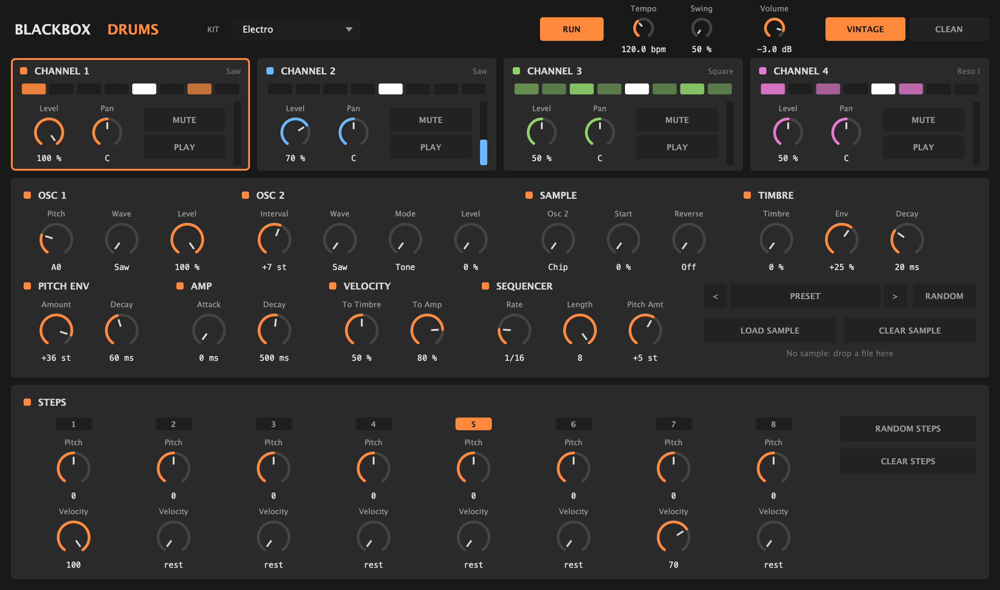

# Blackbox Drums

Electro drums, zaps and bleeps from a Casio CZ sound chip, played by four step sequencers you
control with knobs. A free VST3 and CLAP instrument plugin for macOS.



Blackbox Drums has four channels. Each channel is a complete CZ voice: two oscillators running
on a model of the CZ-101's sound chip, with the chip's own phase distortion waves, resonance,
ring modulation and noise. Like a Moog DFAM, every sound is shaped by three decays (pitch, timbre
and amp), and every channel has an 8-step sequencer with a pitch knob and a velocity knob per step.
Give the channels different lengths and rates and the patterns drift against each other.

- 4 channels, each with its own sound, 8-step pattern, length (1 to 8), rate (1/32 to 1/4,
  triplets too), level, pan and mute
- Follows your DAW's tempo and transport, or runs on its own clock (RUN)
- Swing
- 3 kits and 50 presets: kicks, snares, metal, zaps, bleeps and effects
- Random sound and random steps for every channel
- Load your own samples: osc 2 plays them, and the CZ's phase distortion bends them
- Vintage mode (the chip's own 40 kHz, 12-bit sound) or Clean mode

## Download

Download **[Blackbox-Drums-0.5.0-macOS.zip](Blackbox-Drums-0.5.0-macOS.zip)** (or the newest zip
under [Releases](../../releases)) and double-click it to unzip.

You need:

- macOS 11 (Big Sur) or later, on an Apple Silicon or Intel Mac
- A DAW that loads VST3 or CLAP plugins, such as Bitwig Studio, Ableton Live, Reaper, Cubase or
  FL Studio. There is no Audio Unit version, so it does not run in Logic Pro or GarageBand.
- The CLAP loads in Bitwig Studio, Reaper, FL Studio 2024 and later, and Studio One 6.5 and later.
  Ableton Live and Cubase load only the VST3, so use that one there.

## Install

### 1. Copy the plugins into your plugin folders

The zip holds two plugins. You need only the one your DAW uses, but installing both does no harm.

| File | Copy it to |
| --- | --- |
| `Blackbox Drums.vst3` | `~/Library/Audio/Plug-Ins/VST3/` |
| `Blackbox Drums.clap` | `~/Library/Audio/Plug-Ins/CLAP/` |

To open a folder: in Finder, press **Shift-Command-G**, paste the path and press Return. `~` is
your home folder. If the `CLAP` folder does not exist yet, create it.

### 2. Let macOS open them

macOS checks every app and plugin downloaded from the internet. Blackbox Drums is **signed
ad hoc**, not **notarised by Apple**: notarising needs a paid Apple Developer account, which this
project does not have. The ad-hoc signature is enough for your Mac to run the plugins, including
on Apple Silicon, but macOS still marks the downloaded files as "quarantined" and blocks them. Your
DAW may then skip the plugin, or macOS says it "cannot be opened because Apple cannot check it for
malicious software".

To clear the quarantine, open **Terminal** (in Applications > Utilities) and paste these two lines:

```sh
xattr -dr com.apple.quarantine ~/Library/Audio/Plug-Ins/VST3/"Blackbox Drums.vst3"
xattr -dr com.apple.quarantine ~/Library/Audio/Plug-Ins/CLAP/"Blackbox Drums.clap"
```

Nothing is printed when it works. If you installed only one of the two, the other line says "No
such file", which you can ignore.

If you would rather check the signature first, this shows it (it should say `Signature=adhoc`):

```sh
codesign -dv ~/Library/Audio/Plug-Ins/VST3/"Blackbox Drums.vst3"
```

Instead of Terminal you can also try to load the plugin once, then open **System Settings >
Privacy & Security**, scroll down and click **Open Anyway** next to the message about Blackbox
Drums. Not every DAW makes macOS show that button, so the Terminal lines are the surer way.

### 3. Rescan in your DAW

Restart your DAW or let it rescan its plugins, then load **Blackbox Drums** (by **Blackbox**) on
an instrument track.

## Quick start

1. Press Play in your DAW, or **RUN** in the plugin. The Electro kit plays: kick, snare, hats
   and a zap.
2. Click a channel at the top to see its sound and its steps.
3. Turn the step knobs: **Velocity** at 0 is a rest; **Pitch** moves that step up or down, by
   as much as **Pitch Amt** says.
4. Change a channel's **Length** to 5 or 7 to make its pattern drift against the others.
5. Pick a **KIT** at the top, or a **PRESET** for one channel (`<` and `>` step through them), or
   press **RANDOM**.

## The controls

| Section | Knobs |
| --- | --- |
| Osc 1 | Pitch, Wave (the CZ's 8 waves and pairs of them), Level |
| Osc 2 | Interval from osc 1, Wave, Mode (Tone, Ring: osc 1 times osc 2, Noise), Level |
| Sample | Osc 2 plays the chip or your sample, Start, Reverse |
| Timbre | Timbre (the CZ's DCW, like a filter's cutoff), Env (how far each hit opens it), Decay |
| Pitch Env | Amount (how far above or below the note each hit starts), Decay |
| Amp | Attack, Decay |
| Velocity | How much softer steps close the timbre and lower the level |
| Sequencer | Rate, Length, Pitch Amt (semitones a step's pitch knob reaches) |

Every knob can be automated and MIDI-learned from your DAW. Double-click a knob to reset it.

## Samples

Drop a WAV, AIFF or FLAC file on a channel (or press **LOAD SAMPLE**). Osc 2 then plays the
sample: Interval 0 plays it at its own speed, the pitch envelope and the step pitch change its
speed, and turning up **Timbre** bends it through the CZ's phase distortion. Samples are mixed to
mono, up to 10 seconds, and saved inside your DAW project.

## MIDI

You do not need MIDI to play Blackbox Drums, but you can play it from a keyboard or another
sequencer:

- MIDI channel 1: notes C1, C#1, D1 and D#1 (MIDI notes 36 to 39) play channels 1 to 4.
- MIDI channels 2 to 5 play channels 1 to 4 at the note's pitch; C3 (MIDI note 60) is the
  sound's own pitch.

## Uninstall

Delete `Blackbox Drums.vst3` and `Blackbox Drums.clap` from the folders in step 1.

## Credits

Blackbox Drums' model of the CZ sound chip follows Devin Acker's uPD933 emulation in
[MAME](https://www.mamedev.org/). It is built with [JUCE](https://juce.com) and
[clap-juce-extensions](https://github.com/free-audio/clap-juce-extensions), with the VST3 SDK and
CLAP. Their notices are in [THIRD_PARTY_NOTICES.md](THIRD_PARTY_NOTICES.md), which is also in the zip.

Casio and CZ are trademarks of Casio Computer Co., Ltd. DFAM is a trademark of Moog Music Inc. VST
is a trademark of Steinberg Media Technologies GmbH. Blackbox Drums is not affiliated with or
endorsed by any of them.
